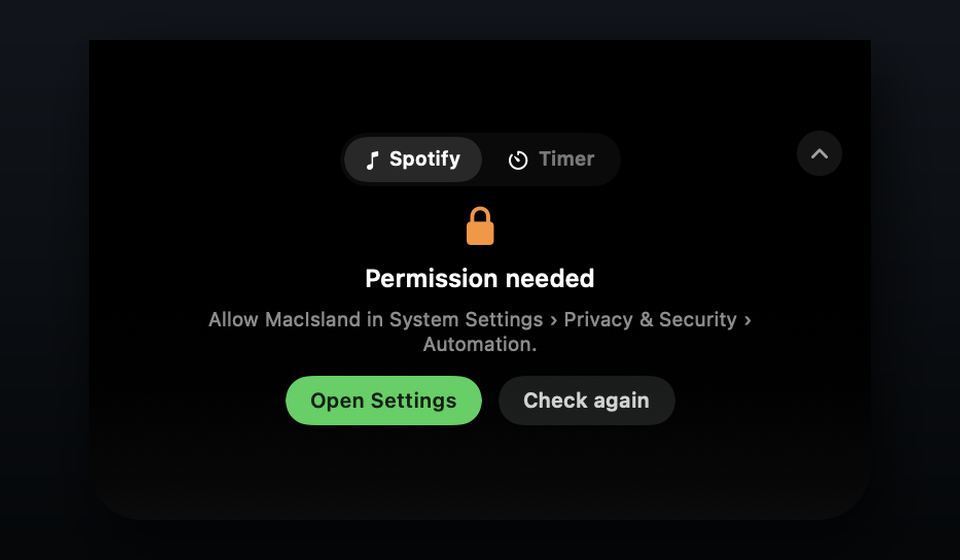

<p align="center">
  
</p>

<h1 align="center">MacIsland</h1>

<p align="center">
  <a href="README.md">English</a> · <a href="README.pt-BR.md">Português (Brasil)</a>
</p>

<p align="center">
  <strong>A dynamic island for your Mac. Music, timers, and more.</strong>
</p>

<p align="center">
  <a href="https://github.com/freitaseric/MacIsland/actions/workflows/build.yml"></a>
  <a href="https://github.com/freitaseric/MacIsland/releases"></a>
  <a href="LICENSE"></a>
  <a href="#requirements"></a>
</p>

<p align="center">
  
</p>

MacIsland makes the area around your MacBook's notch useful. The island is the
product: a small, always-there surface for the things you need at a glance.
Version 1 combines a polished Spotify player with a focus timer, and the
island is built to host more integrations over time.

Built with SwiftUI and a borderless `NSPanel` that sits above the menu bar.
No accounts, no analytics, no Spotify login: just the Spotify app you already
have.

## The idea

The notch is always in view. MacIsland gives it a purpose beyond a camera
cutout. Today it's music and focus timers; the same surface can grow into
calendar events, system actions, and whatever else deserves a glance.

## Features

- **Notch-native layout** — the black surface blends into the notch and expands
  into a compact player card.
- **Made to grow** — the island is the product, not a single-purpose music
  widget. Spotify is the first integration, not the ceiling.
- **Focus timer** — 5, 15, and 25-minute presets with start, pause, reset, and a
  local notification when the countdown ends.
- **Feature switcher** — move between Spotify and the timer without leaving the
  island.
- **Now playing at a glance** — album artwork, title, artist, album, elapsed
  time, and duration.
- **Playback controls** — play/pause, previous, and next with optimistic UI
  updates.
- **Looks after itself** — refreshes automatically when Spotify opens, quits,
  changes track, or is paused.
- **Hover, Escape, and click-outside** — expand on hover, collapse with Escape,
  or click away. Click still works too.
- **Smooth progress** — interpolated between Spotify polls instead of jumping
  every two seconds.
- **Out of the way** — hides automatically when another app goes full-screen
  (including borderless games) and comes back when you leave.
- **Clear states** — helpful screens for missing Automation permission, Spotify
  closed, nothing playing, and unexpected errors.
- **Menu bar companion** — show/hide the island, open Spotify, jump to the
  timer, refresh, launch at login, about, and quit.
- **English and Brazilian Portuguese** — follows your system language.
- **No Dock icon** — a focused menu bar utility.
- **Universal and notarized releases** — Apple Silicon and Intel, signed with
  Developer ID and notarized by Apple.

## Screenshots

<p align="center">
  
</p>

<p align="center">
  
</p>

<p align="center">
  
</p>

## Requirements

- macOS **14 Sonoma** or later.
- The **Spotify desktop app** installed and signed in.
- A MacBook with a notch for the intended look. On other displays, MacIsland
  becomes a floating pill just below the menu bar.
- Apple Silicon or Intel Mac.

## Install

> **Source available now.** The first signed and notarized binary is being
> prepared. Until it lands in Releases, build from source using the steps below.

1. Download the latest `MacIsland-x.y.z.zip` from
   [Releases](https://github.com/freitaseric/MacIsland/releases).
2. Unzip it and drag **MacIsland.app** into `/Applications`.
3. Open MacIsland. On first launch, macOS asks whether MacIsland may control
   Spotify — choose **OK**.
4. Click the compact island (or the waveform icon in the menu bar) to open the
   player.

Official releases are signed with a Developer ID certificate and notarized by
Apple. If you build the app yourself, that is not required for local use.

## Usage

- **Expand / collapse**: click the compact island to expand, and the chevron in
  the top-right corner to collapse.
- **Playback**: use the previous, play/pause, and next buttons.
- **Menu bar icon**: show or hide the island, open Spotify, refresh, enable
  **Open at Login**, open **About**, or quit.
- **Open at Login**: enable it from the menu bar. macOS may ask you to approve
  MacIsland under **System Settings → General → Login Items**. The app works
  best when it lives in `/Applications`.
- **Multiple displays**: MacIsland prefers the built-in display with a notch.
  On a display without a notch it appears as a floating pill below the menu bar.
- **Full-screen apps**: the island hides automatically while another app is in
  full-screen and returns when you leave it.

## Automation permission

MacIsland talks to Spotify through AppleScript, so macOS requires your
permission once:

**System Settings → Privacy & Security → Automation → MacIsland → Spotify.**

If the island shows **Permission needed**, click **Open Settings** and enable
Spotify for MacIsland.

If the prompt never appears, quit the app, reset the permission, and open it
again:

```bash
tccutil reset AppleEvents com.freitaseric.MacIsland
```

## Build from source

You need **Xcode 26.6 or newer** (tested with Xcode 27.1) and the macOS 14 SDK
or newer. Older versions may not support the Swift concurrency settings used here.

```bash
git clone https://github.com/freitaseric/MacIsland.git
cd MacIsland
open MacIsland.xcodeproj
```

In Xcode:

1. Select the **MacIsland** target → **Signing & Capabilities**.
2. Choose your team (or **Sign to Run Locally** if you just want to run it).
3. Press **Run**.

The Apple Events entitlement is already configured in
`MacIsland/MacIsland.entitlements`, and the usage description is in
`Config/Info.plist` plus the localized `MacIsland/InfoPlist.xcstrings`.

Command-line build:

```bash
xcodebuild \
  -project MacIsland.xcodeproj \
  -scheme MacIsland \
  -configuration Debug \
  -destination 'platform=macOS' \
  build
```

## How it works

- A borderless, non-activating `NSPanel` sits at the `.statusBar` window level
  and is anchored to the top edge of the screen.
- `NSScreen.auxiliaryTopLeftArea` / `safeAreaInsets` detect the notch and the
  menu bar height, so the island can grow downward from the notch.
- A `MusicService` polls Spotify through `NSAppleScript` every two seconds,
  parsing a typed AppleScript record with the track, artwork URL, playback
  state, duration, and position.
- Playback commands are sent with `playpause`, `next track`, and
  `previous track`, with optimistic UI state and a refresh after each command.
- The app is not sandboxed because it needs to send Apple Events to Spotify.
  It uses the Hardened Runtime with the
  `com.apple.security.automation.apple-events` entitlement.

## Privacy

- No accounts, analytics, telemetry, or tracking.
- No Spotify credentials are read or stored.
- Network access is only used to load album artwork from Spotify's image CDN.
- The only system permissions are **Automation** (Spotify) and **notifications**
  (requested only when you start the timer).
- The source is open — you can audit every line.

## Known limitations

- Version 1 ships two integrations: Spotify and a focus timer. There is no
  plugin system for third-party features yet.
- Spotify is the only music source.
- The focus timer stops if the app quits.
- No automatic updates yet.
- Distributed outside the Mac App Store, so the app runs without the App
  Sandbox.
- The notch layout is tuned for the built-in MacBook display; external displays
  get the floating-pill fallback.

## Roadmap

- More integrations: focus modes, calendar events, and system actions.
- A small integration surface for third-party actions.
- More music sources, including Apple Music.
- Timer history and persistence across app restarts.
- Auto-updates with Sparkle.
- Homebrew Cask.
- More appearance and behavior settings.

## Contributing

Issues and pull requests are welcome. Keep changes focused and test with
`xcodebuild` before opening a PR. For bigger changes, open an issue first.

## License

[MIT](LICENSE) © 2026 Eric Freitas Sampaio.

## Disclaimer

MacIsland is an independent project. It is not affiliated with, endorsed by, or
sponsored by Spotify or Apple. Spotify is a trademark of Spotify AB. MacBook and
Mac are trademarks of Apple Inc.
