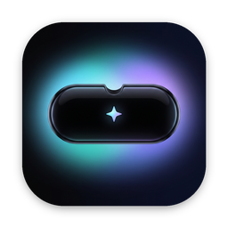
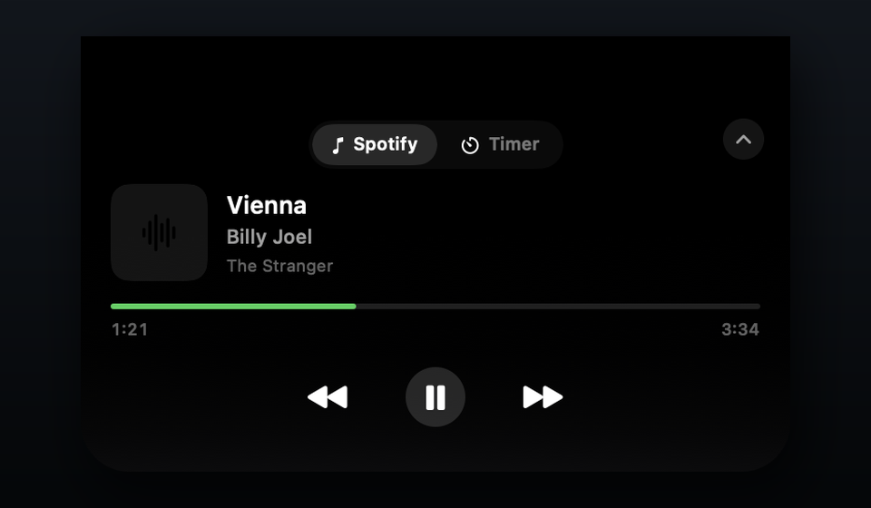
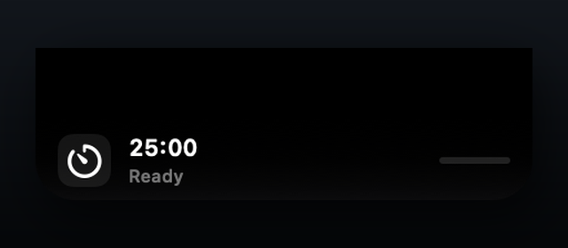
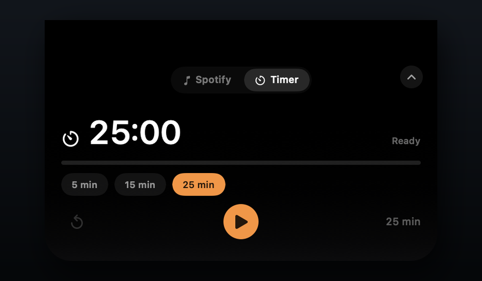
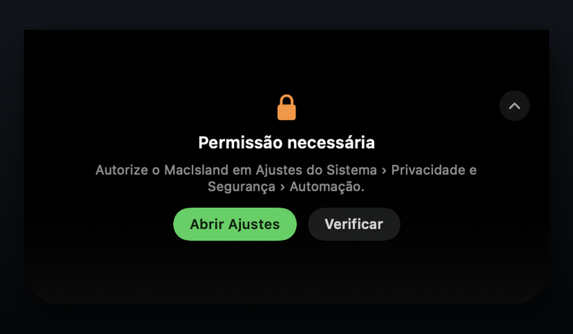

<p align="center">
  
</p>

<h1 align="center">MacIsland</h1>

<p align="center">
  <a href="README.md">English</a> · <a href="README.pt-BR.md">Português (Brasil)</a>
</p>

<p align="center">
  <strong>Uma dynamic island para o seu Mac. Música, timers e mais.</strong>
</p>

<p align="center">
  <a href="https://github.com/freitaseric/MacIsland/actions/workflows/build.yml"></a>
  <a href="https://github.com/freitaseric/MacIsland/releases"></a>
  <a href="LICENSE"></a>
  <a href="#requisitos"></a>
</p>

<p align="center">
  
</p>

O MacIsland transforma a área em volta do notch do MacBook em algo útil. A
ilha é o produto: uma superfície pequena e sempre presente para o que você
precisa ver de relance. A versão 1 combina um player de Spotify caprichado
com um timer de foco, e a ilha foi feita para receber mais integrações com o
tempo.

Feito em SwiftUI, com um `NSPanel` sem borda que fica acima da menu bar. Sem
contas, sem analytics e sem login no Spotify: só o app do Spotify que você já
usa.

## A ideia

O notch está sempre à vista. O MacIsland dá a ele um propósito além da câmera.
Hoje é música e timers de foco; a mesma superfície pode crescer para eventos
da agenda, ações do sistema e o que mais merecer um relance.

## Recursos

- **Feito para o notch** — a superfície preta se funde ao notch e se expande em
  um cartão compacto de player.
- **Feita para crescer** — a ilha é o produto, não um widget de música. O
  Spotify é a primeira integração, não o teto.
- **Timer de foco** — presets de 5, 15 e 25 minutos com iniciar, pausar,
  reiniciar e uma notificação local no fim.
- **Seletor de features** — alterne entre Spotify e timer sem sair da ilha.
- **O que está tocando** — capa, título, artista, álbum, tempo decorrido e
  duração.
- **Controles** — play/pause, anterior e próxima, com atualização otimista da
  interface.
- **Atualização automática** — reage quando o Spotify abre, fecha, troca de
  faixa ou pausa.
- **Hover, Escape e clique fora** — expanda ao passar o mouse, recolha com
  Escape ou clicando fora. O clique também continua funcionando.
- **Progresso suave** — interpolado entre os polls do Spotify, sem saltos a
  cada dois segundos.
- **Sai da frente** — esconde automaticamente quando outro app entra em tela
  cheia (inclusive jogos borderless) e volta ao sair.
- **Estados claros** — telas para permissão de Automação, Spotify fechado, nada
  tocando e erros inesperados.
- **Menu bar completo** — mostrar/ocultar, expandir/recolher, abrir o Spotify,
  ir para o timer, atualizar, abrir no login, sobre e sair.
- **Inglês e português do Brasil** — segue o idioma do sistema.
- **Sem ícone no Dock** — um utilitário focado na menu bar.
- **Releases universais e notarizadas** — Apple Silicon e Intel, assinadas com
  Developer ID e notarizadas pela Apple.

## Capturas de tela

<p align="center">
  
</p>

<p align="center">
  
</p>

<p align="center">
  
</p>

## Requisitos

- macOS **14 Sonoma** ou superior.
- **Spotify desktop** instalado e com login feito.
- Um MacBook com notch para o visual pretendido. Em outras telas, o MacIsland
  vira uma pílula flutuante logo abaixo da menu bar.
- Mac com Apple Silicon ou Intel.

## Instalação

> **Código-fonte disponível agora.** O primeiro binário assinado e notarizado
> está sendo preparado. Até ele chegar em Releases, compile a partir do código.

1. Baixe o `MacIsland-x.y.z.zip` mais recente em
   [Releases](https://github.com/freitaseric/MacIsland/releases).
2. Descompacte e arraste o **MacIsland.app** para `/Applications`.
3. Abra o MacIsland. Na primeira execução, o macOS pergunta se o MacIsland pode
   controlar o Spotify — escolha **OK**.
4. Clique na ilha compacta (ou no ícone de waveform na menu bar) para abrir o
   player.

As releases oficiais são assinadas com um certificado Developer ID e
notarizadas pela Apple. Se você compilar o app por conta própria, isso não é
necessário para uso local.

## Uso

- **Expandir / recolher**: clique na ilha compacta para expandir e no chevron
  no canto superior direito para recolher.
- **Reprodução**: use os botões de anterior, play/pause e próxima.
- **Ícone na menu bar**: mostrar/ocultar a ilha, abrir o Spotify, atualizar,
  ativar **Abrir no login**, ver **Sobre** ou sair.
- **Abrir no login**: ative pela menu bar. O macOS pode pedir aprovação em
  **Ajustes do Sistema → Geral → Itens de Login**. O app funciona melhor quando
  está em `/Applications`.
- **Múltiplas telas**: o MacIsland prioriza a tela integrada com notch. Em uma
  tela sem notch, ele aparece como uma pílula flutuante abaixo da menu bar.
- **Apps em tela cheia**: a ilha se esconde automaticamente enquanto outro app
  está em tela cheia e volta quando você sai.

## Permissão de Automação

O MacIsland conversa com o Spotify via AppleScript, então o macOS pede sua
permissão uma vez:

**Ajustes do Sistema → Privacidade e Segurança → Automação → MacIsland → Spotify.**

Se a ilha mostrar **Permissão necessária**, clique em **Abrir Ajustes** e ative
o Spotify para o MacIsland.

Se o diálogo nunca aparecer, feche o app, resete a permissão e abra de novo:

```bash
tccutil reset AppleEvents com.freitaseric.MacIsland
```

## Compilar do código-fonte

Você precisa do **Xcode 26.6 ou superior** (testado com o 27.1) e do SDK do
macOS 14 ou superior. Versões mais antigas podem não suportar as opções
de concorrência do Swift usadas aqui.

```bash
git clone https://github.com/freitaseric/MacIsland.git
cd MacIsland
open MacIsland.xcodeproj
```

No Xcode:

1. Selecione o target **MacIsland** → **Signing & Capabilities**.
2. Escolha seu time (ou **Sign to Run Locally** se for só rodar localmente).
3. Pressione **Run**.

O entitlement de Apple Events já está configurado em
`MacIsland/MacIsland.entitlements`, e a descrição de uso fica em
`Config/Info.plist` e em `MacIsland/InfoPlist.xcstrings` (localizada).

Build pela linha de comando:

```bash
xcodebuild \
  -project MacIsland.xcodeproj \
  -scheme MacIsland \
  -configuration Debug \
  -destination 'platform=macOS' \
  build
```

## Como funciona

- Um `NSPanel` sem borda e não ativável fica no nível `.statusBar` e é ancorado
  no topo da tela.
- `NSScreen.auxiliaryTopLeftArea` e `safeAreaInsets` detectam o notch e a
  altura da menu bar, para a ilha crescer para baixo a partir do notch.
- Um `MusicService` consulta o Spotify via `NSAppleScript` a cada dois segundos,
  lendo um record tipado com faixa, URL da capa, estado, duração e posição.
- Os comandos usam `playpause`, `next track` e `previous track`, com estado
  otimista e refresh depois de cada comando.
- O app não usa App Sandbox porque precisa enviar Apple Events para o Spotify.
  Ele usa Hardened Runtime com o entitlement
  `com.apple.security.automation.apple-events`.

## Privacidade

- Sem contas, analytics, telemetria ou rastreamento.
- Nenhuma credencial do Spotify é lida ou armazenada.
- A rede só é usada para carregar a capa do CDN de imagens do Spotify.
- As únicas permissões do sistema são **Automação** (Spotify) e **notificações**
  (pedidas só quando você inicia o timer).
- O código é aberto — dá para auditar cada linha.

## Limitações conhecidas

- A versão 1 traz duas integrações: Spotify e um timer de foco. Ainda não há
  sistema de plugins para features de terceiros.
- O Spotify é a única fonte de música.
- O timer para se o app for fechado.
- Ainda não há atualização automática.
- Distribuído fora da Mac App Store, então roda sem App Sandbox.
- O layout do notch é pensado para a tela integrada do MacBook; monitores
  externos recebem a pílula flutuante.

## Roadmap

- Mais integrações: modos de foco, agenda e ações do sistema.
- Uma superfície de integração para ações de terceiros.
- Mais fontes de música, incluindo Apple Music.
- Histórico de timers e persistência entre reinícios do app.
- Atualizações automáticas com Sparkle.
- Homebrew Cask.
- Mais opções de aparência e comportamento.

## Contribuindo

Issues e pull requests são bem-vindos. Mantenha as mudanças focadas e teste com
`xcodebuild` antes de abrir um PR. Para mudanças maiores, abra uma issue primeiro.

## Licença

[MIT](LICENSE) © 2026 Eric Freitas Sampaio.

## Aviso

O MacIsland é um projeto independente. Não é afiliado, endossado ou patrocinado
pelo Spotify ou pela Apple. Spotify é uma marca da Spotify AB. MacBook e Mac são
marcas da Apple Inc.
